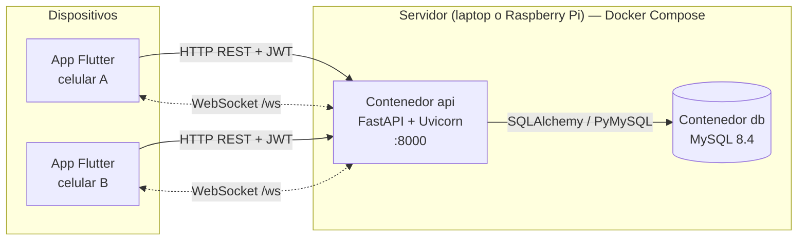
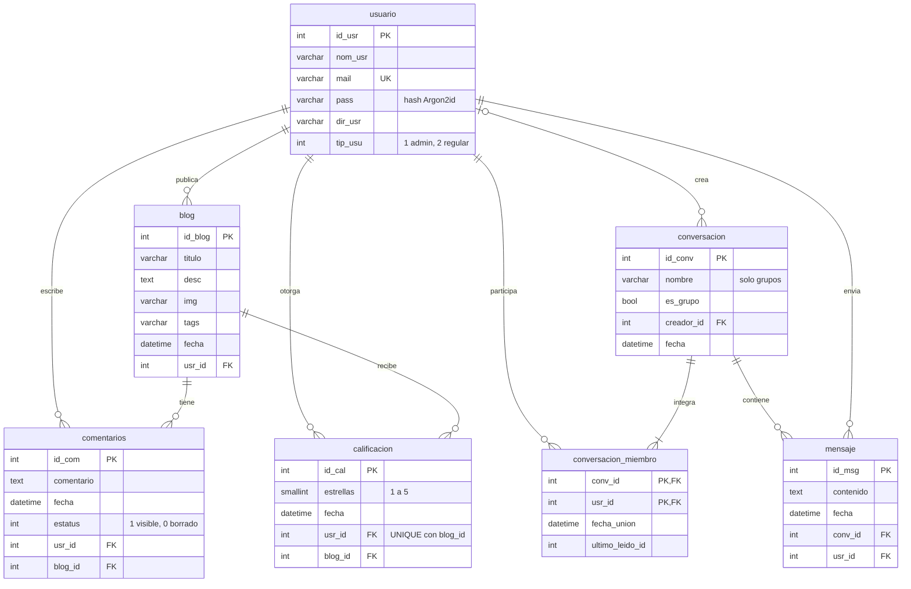
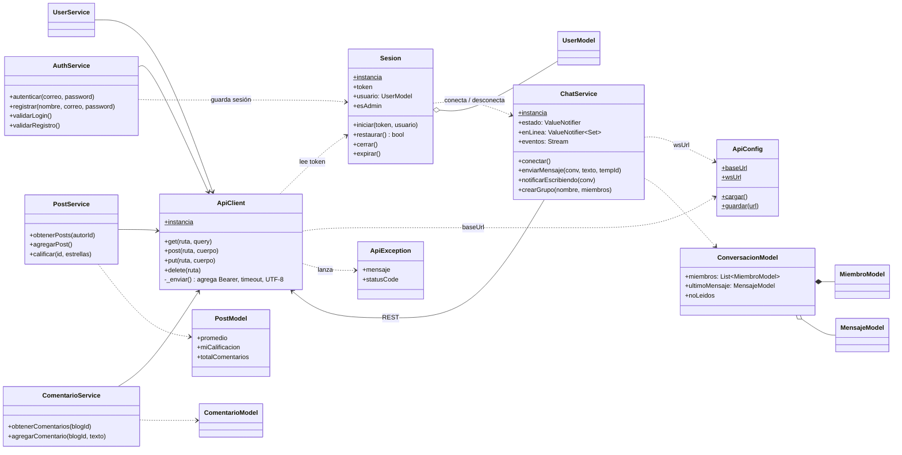
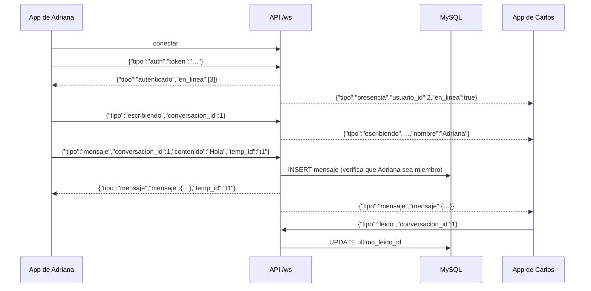

# Arquitectura y seguridad

## 1. Vista general

- **REST** para todo lo que se consulta o modifica (usuarios, blog, comentarios, calificaciones, administración de chats).
- **WebSocket** para lo que debe llegar al instante: mensajes, "escribiendo..." y estado en línea.
- La API corre con un solo proceso: el registro de conexiones WebSocket (`gestor_conexiones.py`) vive en memoria.

## 2. Modelo de datos

Decisiones:

- **Un chat directo y un grupo son la misma entidad** (`conversacion`), lo que permite reutilizar mensajes, no leídos y notificaciones.
- **No leídos** = mensajes de otros con `id_msg > ultimo_leido_id` del miembro; no se guarda un registro por mensaje.
- `UNIQUE (usr_id, blog_id)` en `calificacion` garantiza un voto por usuario; `CHECK` limita las estrellas a 1–5.
- Todas las llaves foráneas tienen `ON DELETE CASCADE`: al eliminar un usuario se borran sus publicaciones, comentarios, votos y mensajes sin dejar registros huérfanos.
- Las fechas se guardan en **UTC** y la app las convierte a la hora local del dispositivo.

## 3. Diagrama de clases (app Flutter)

Pantallas (`screens/`): `LoginPage`, `RegisterPage`, `BlogPage`, `PostDetailPage`, `AddBlogPage`, `ProfilePage`, `UsersPage` *(admin)*, `ChatsPage`, `ChatPage`, `SeleccionarUsuariosPage`, `GrupoInfoPage`.

## 4. Mecanismos de seguridad

| Amenaza | Mecanismo | Dónde |
|---|---|---|
| Robo de la BD expone contraseñas | Hash **Argon2id** (`pwdlib`), con sal aleatoria por usuario; nunca se guarda ni devuelve la contraseña | `seguridad.py` |
| Adivinar qué correos existen | Mismo mensaje y **mismo tiempo de respuesta** para correo inexistente o contraseña incorrecta (se verifica un hash de relleno) | `seguridad.verificar_password` |
| Fuerza bruta | Tras **5 intentos fallidos** el correo se bloquea 5 minutos (HTTP 429) | `routers/auth.py` |
| Suplantar a otro usuario | El autor de posts, comentarios, votos y mensajes se toma **del token**, nunca del cuerpo de la petición | `routers/*` |
| Sesiones falsificadas | **JWT firmado HS256** con `SECRET_KEY` de 64 caracteres y **expiración** (`exp`, 12 h) | `seguridad.crear_token` |
| Token de un usuario eliminado o degradado | En cada petición se vuelve a cargar el usuario de la BD | `seguridad.usuario_desde_token` |
| Escalar a administrador | El registro público fuerza `tip_usu = 2`; sólo un admin cambia roles y no el suyo propio | `routers/auth.py`, `routers/usuarios.py` |
| Acceso indebido | Dependencias `usuario_actual` (401) y `solo_admin` (403); verificación de dueño en editar/borrar; un chat ajeno responde 404 | `seguridad.py`, `routers/*` |
| Token en registros del servidor | El WebSocket recibe el token en el **primer mensaje**, no en la URL; si no llega en 10 s se cierra con código 1008 | `routers/chat.py` |
| Token robado del teléfono | Se guarda en **almacenamiento seguro** del sistema (Android Keystore / iOS Keychain / libsecret) | `services/sesion.dart` |
| Token vencido en la app | Cualquier respuesta 401 cierra la sesión local y regresa al login | `services/api_client.dart` |
| Entradas maliciosas | Validación con Pydantic (longitudes, formato de correo, URLs `http(s)`, estrellas 1–5); consultas parametrizadas con SQLAlchemy (sin SQL inyectable) | `schemas.py` |
| Fugas de errores internos | Manejadores globales: errores de integridad → 409, BD caída → 503, sin detalles de MySQL | `main.py` |
| Contenedor comprometido | La API corre como usuario sin privilegios dentro del contenedor; secretos en `.env` fuera del repositorio | `Dockerfile`, `.gitignore` |

**Limitación conocida:** el tráfico viaja por HTTP sin cifrar dentro de la red local (Android lo permite con `usesCleartextTraffic`). Para publicarlo en internet habría que poner un proxy inverso con HTTPS (Caddy o Nginx + Let's Encrypt) delante del puerto 8000; la app ya soporta `https://` y `wss://`.

## 5. Protocolo del WebSocket

| Cliente → servidor | Servidor → cliente |
|---|---|
| `auth` (obligatorio, primero) | `autenticado` (con usuarios en línea) |
| `mensaje` | `mensaje` (a todos los miembros, eco con `temp_id` al remitente) |
| `escribiendo` | `escribiendo` (a los demás miembros) |
| `leido` | `presencia` (alguien se conectó / desconectó) |
| `ping` | `pong` |
| | `conversacion` (chat o grupo creado / modificado) |
| | `conversacion_eliminada` (saliste del grupo) |
| | `error` (con `temp_id` si fue un mensaje) |

En la app, el mensaje se muestra al instante con un ícono de reloj (envío optimista) y cambia a ✓ cuando llega el eco del servidor con el mismo `temp_id`. Si no hay WebSocket, `ChatService` usa `POST /chats/{id}/mensajes`. Si la conexión se pierde, se reintenta con espera creciente (1, 2, 4… hasta 30 s) y al reconectar se recargan los mensajes perdidos.

## 6. Librerías

| Lado | Librería | Uso |
|---|---|---|
| API | FastAPI, Uvicorn | Framework web, servidor ASGI con soporte WebSocket |
| API | SQLAlchemy, PyMySQL | ORM y driver de MySQL |
| API | Pydantic | Validación de datos |
| API | pwdlib[argon2] | Hash de contraseñas Argon2id |
| API | PyJWT | Tokens de sesión |
| App | http | Peticiones REST |
| App | web_socket_channel | Cliente WebSocket (móvil, escritorio y web) |
| App | flutter_secure_storage | Guardar el token cifrado |
| App | shared_preferences | Recordar la URL del servidor |
| Infra | Docker Compose, MySQL 8.4 | Servidor reproducible en x86_64 y arm64 |

La app no usa cámara, GPS ni otros sensores. Las imágenes de las publicaciones se cargan desde URLs (`Image.network`) con un ícono de respaldo si fallan; los avatares se generan con las iniciales del usuario.
